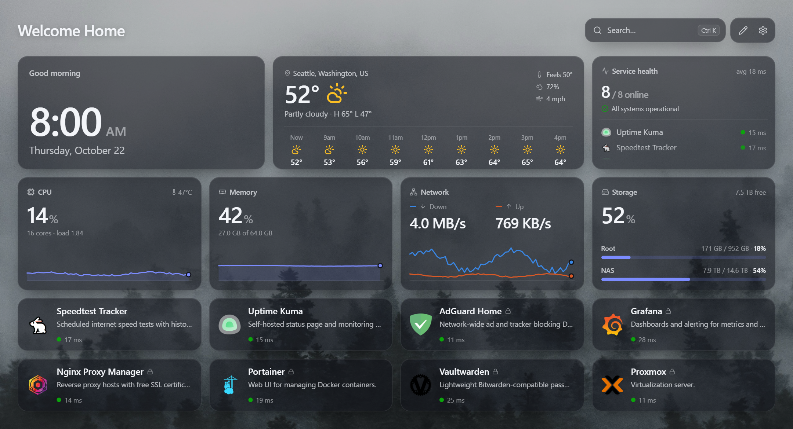

# Home Dash

A dashboard for self-hosted home services.



## Features

- **Tile manager** – press <kbd>E</kbd> (or the pencil icon) to edit: drag tiles to rearrange, pull the corner handle to resize, use the gear to configure a tile, and the trash icon to remove it (with undo).
- **Boards** – group tiles into multiple boards (tabs). In edit mode, use <kbd>+</kbd> to add one and double-click a tab to rename it. Press <kbd>1</kbd>–<kbd>9</kbd> to switch boards.
- **Widgets** – clock (with world time zones), weather (hourly + 7-day), search, calendar, notes, CPU, memory, storage, network, system overview, service health, service lists, service launchers and custom links.
- **Live metrics** – CPU, memory, disk and network throughput from the host running the dashboard, plus health checks and latency for every service.
- **Personalisation** – dark / light / auto theme, accent colour, background presets (including an animated aurora), solid colours, image URLs or your own uploaded image, plus dim/blur, tile opacity, glass blur, corner radius and grid density.
- **Command palette** – press <kbd>Ctrl</kbd>+<kbd>K</kbd> or <kbd>/</kbd> to jump to a service, run an action or search the web.

Layout and settings are stored in your browser. Use **Settings → Data** to export them and import them on another device.

## Configuration

| Variable | Purpose |
| --- | --- |
| `OPENWEATHER_LATITUDE` / `OPENWEATHER_LONGITUDE` | Default weather location. You can also pick a city in **Settings → General**. Weather uses [Open-Meteo](https://open-meteo.com/), so no API key is needed. |
| `DISK_PATHS` | Optional comma-separated mounts for the Storage widget, e.g. `Root=/,NAS=/mnt/nas`. Defaults to the drive the app runs from. |

Service health checks run on the server: any HTTP response below 500 counts as online, and self-signed certificates are accepted.

## Proxmox cluster

Home Dash can show your whole Proxmox VE cluster: cluster-wide CPU, memory and storage, quorum, a tile per node with the last hour of history, every VM and container, and storage pools. It talks to the Proxmox API with a **read-only** API token, which stays on the server and is never sent to the browser.

### 1. Create a read-only API token

Run this in the shell of any node (cluster users and tokens are shared by every node):

```bash
pveum user add homedash@pve --comment "Home Dash (read-only)"
pveum acl modify / --users homedash@pve --roles PVEAuditor
pveum user token add homedash@pve dashboard --privsep 0
```

The last command prints the token secret **once**, so copy it. `PVEAuditor` can read everything and change nothing. `--privsep 0` makes the token inherit the user's permissions.

### 2. Configure Home Dash

Add these to `.env`:

```bash
PROXMOX_URL=https://192.168.1.10:8006,https://192.168.1.11:8006
PROXMOX_TOKEN_ID=homedash@pve!dashboard
PROXMOX_TOKEN_SECRET=<the secret from step 1>
```

- List one or more nodes. Any node can answer for the whole cluster; the others are fallbacks if it's down.
- Proxmox's default self-signed certificate is accepted. If your nodes have trusted certificates (for example behind your reverse proxy), set `PROXMOX_VERIFY_TLS=true`.

Restart the container, then open **Add widget → Create a Proxmox board** (or press <kbd>Ctrl</kbd>+<kbd>K</kbd> and run *Create a Proxmox board*). Individual widgets are also in the library under **Proxmox**.

### Running in a Proxmox LXC

- Docker inside an LXC needs the container's **nesting** and **keyctl** features enabled (*Options → Features*).
- The LXC must be able to reach the nodes on port 8006 (or wherever `PROXMOX_URL` points).
- The CPU, Memory, Network and Storage widgets in the **Metrics** category describe the machine running Home Dash. In an LXC that's the container itself. Use the **Proxmox** widgets for the cluster.

## Adding Your Own Services

To add a new service to the Home Dash dashboard, you need to update the `services.json` file. This file stores the information for each service displayed on the dashboard, such as the service name, URL, icon, description, and whether the service is private or public.

### Steps to Add a Service:

1. **Locate the `services.json` file**. The file is located in the `src/data/` directory of your project. If it does not exist, create it in this location.

2. **Add a new service**: Each service is represented as an object within an array. Add your new service by following the format below:

```json
[
  {
    "name": "Service Name",
    "url": "https://your-service-url.com/",
    "icon": "/service-icons/service-icon.png",
    "description": "A brief description of what the service does.",
    "private": true,
    "group": "infrastructure"
  }
]
```

`group` is optional (`public`, `private` or `infrastructure`). It defaults to `private` or `public` based on the `private` flag. New services appear on your first board automatically, and changes to `services.json` are picked up without a rebuild.

## Running with Docker

Home Dash supports both **regular Docker** and **Docker Compose**.

### Using Regular Docker

1. Build the image:
   ```bash
   docker build -t home-dash .
   ```

2. Run the container:
   ```bash
   docker run -d --name home-dash -p 3000:3000 --env-file .env home-dash
   ```

3. Stop and remove the container:
   ```bash
   docker stop home-dash && docker rm home-dash
   ```

### Using Docker Compose

1. Make sure Docker Compose is installed.

2. Build and start the container:
   ```bash
   docker compose up -d --build
   ```

3. Stop the container:
   ```bash
   docker compose down
   ```

### Cleaning Up Docker

To remove unused containers, images, and networks:

```bash
docker system prune -a
```

> Note: Ensure you have a `.env` file with any required environment variables before running the container.
